<p align="center">
  <a href="https://aiwithrakshith.tech/">
    
  </a>
</p>

<p align="center">
  <a href="https://aiwithrakshith.tech/"></a>
</p>

<p align="center">
  <a href="https://aiwithrakshith.tech/"></a>
  <a href="https://aiwithrakshith.tech/booking"></a>
  
</p>

## 🚀 About Me

<p align="center">
  <a href="https://instagram.com/mydesignnexus.in"></a>
  <a href="https://aiwithrakshith.tech/#about"></a>
</p>
<p align="center">
  <a href="https://aiwithrakshith.tech/#stack"></a>
  <a href="https://aiwithrakshith.tech/#about"></a>
</p>
<p align="center">
  <a href="https://www.instagram.com/aiwithrakshi.global"></a>
  <a href="https://instagram.com/aiwithrakshi"></a>
</p>

<details>
<summary><b>Read as text</b></summary>

<br>

**Hi, I'm Rakshith 👋** · Founder & CEO, MyDesignNexus · AI Generalist
I help businesses put AI to work: automation, AI calling agents, custom software and AI-produced content.
📍 Hassan & Bengaluru, Karnataka, India

- 🏢 Founder & CEO of **MyDesignNexus**, an MSME-registered AI solutions company
- 🎓 Computer Science Engineering graduate (2025); went straight into entrepreneurship
- 🧠 Hands-on with **300+ AI tools** (91 premium), with **20+ projects** delivered
- 🌍 Learned AI and tech through US-based communities, then freelanced
- 🎬 **3.2M+ Reel plays** on @aiwithrakshi.global, with a top Reel at 1.6M
- 🗣️ Teaching AI in Kannada for Karnataka creators, SME owners and students

</details>

---

## ✨ Skills

UI, UX and development, end to end.

| UI Design | UX Design | Development |
|-----------|-----------|-------------|
| Visual design | User flows | React & TypeScript |
| Design systems | Wireframes | PWAs & mobile apps |
| Figma | Prototyping | Supabase |
| Framer | Information architecture | n8n automation |
| Motion & micro-interactions | UX research | AI agents & voice |
| Responsive layouts | Usability reviews | APIs & integrations |

---

## 🛠️ What I Work On

<p align="center">
  <a href="https://aiwithrakshith.tech/#work"></a>
  <a href="https://aiwithrakshith.tech/#work"></a>
  <a href="https://aiwithrakshith.tech/#work"></a>
</p>
<p align="center">
  <a href="https://aiwithrakshith.tech/#work"></a>
  <a href="https://aiwithrakshith.tech/#work"></a>
  <a href="https://aiwithrakshith.tech/#work"></a>
</p>

<details>
<summary><b>Read as text</b></summary>

<br>

| Area | What I Do |
|------|-----------|
| 🤖 **AI Automation** | Workflow automation and business systems for SMEs |
| 📞 **AI Calling Agents** | Voice agents for sales, support and lead handling |
| 🌐 **Web & App Development** | Websites, PWAs and mobile apps |
| ⚙️ **Custom Software** | Tailored tools for real business problems |
| 🎬 **AI Content Production** | AI video, UGC ads and visual content |
| 📚 **AI Education** | Kannada-first AI learning content |

</details>

---

## 🎬 Showcase

Featured productions, crafted with AI: **AI films and ad creatives** in 16:9, and **AI avatar videos** in 9:16 for Reels and Shorts, from MDN Creatives.
[Watch them on my website →](https://aiwithrakshith.tech/#showcase)

---

## 📦 My Products

<p align="center">
  
</p>

- **ContentBrisk**: a content management system for creators and brands *(launching soon)*
- **Adsynthra**: an AI-powered ad platform *(coming soon)*

---

## 🧰 Premium AI Tools I Use

<p align="center">
  <a href="https://aiwithrakshith.tech/#stack">
    
  </a>
</p>

<details>
<summary><b>See the full list as text</b></summary>

<br>

| Category | Tools |
|----------|-------|
| **AI Chat** | DeepSeek, ChatGPT, Claude, Grok, NotebookLM, Gemini, Manus, Perplexity, Ollama, MiniMax |
| **Build & Code** | Bolt.new, Lovable, Emergent, Replit, GitHub, Cursor, Antigravity |
| **Image** | Leonardo.ai, Ideogram, Adobe Firefly, Midjourney, Magnific, OpenArt, Kie.ai, Kalakar, Krea, ComfyUI, Picsart, Enhancor |
| **Video** | Higgsfield, Flow, Adobe Premiere Pro, Runway, VEED, Pika, Kling, Descript, Remotion, Opus Clip, Hailuo, Sora, Luma, LTX Studio, InVideo AI, vidIQ, Filmora |
| **Audio & Voice** | Mirelo.ai, ElevenLabs, Retell AI, Twilio, Suno, Sarvam AI, Vapi |
| **Automation** | n8n, Zapier, Make.com, Apify, MailerLite, Blotato, Firecrawl |
| **Design** | Canva, Figma, Magic Patterns, Lovart, Framer, Dora Run, Gamma, Mobbin |
| **Productivity** | ClickUp, Loom, Slack, Notion, Wispr Flow, Grammarly, Superhuman, Linear, GravityWrite, Linktree |
| **Backend & Deploy** | Cloudflare, Supabase, Clerk, Resend, Vercel, OpenRouter, Google Firebase, Hugging Face, Replicate, Railway |
| **3D** | Meshy, Tripo3D |
| **Payments** | Razorpay |

</details>

---

## 📱 Find Me

<p align="center">
  <a href="https://aiwithrakshith.tech/"></a>
  <a href="https://aiwithrakshith.tech/booking"></a>
  <a href="https://aiwithrakshith.tech/"></a>
</p>
<p align="center">
  <a href="https://instagram.com/aiwithrakshi"></a>
  <a href="https://www.instagram.com/aiwithrakshi.global"></a>
  <a href="https://instagram.com/mydesignnexus.in"></a>
</p>

<details>
<summary><b>Read as text</b></summary>

<br>

- Website: **[aiwithrakshith.tech](https://aiwithrakshith.tech/)**
- Book a free 1:1 call (Mon–Fri, 9 AM–4 PM IST): [aiwithrakshith.tech/booking](https://aiwithrakshith.tech/booking)
- AI assistant: talk or chat with "Ask Rakshith's AI" on [my website](https://aiwithrakshith.tech/)
- Instagram (Kannada): [@AIwithRakshith](https://instagram.com/aiwithrakshi)
- Instagram (Global): [@aiwithrakshi.global](https://www.instagram.com/aiwithrakshi.global)
- Company: **[@mydesignnexus.in](https://instagram.com/mydesignnexus.in)**

</details>

---

⭐ *Building AI for India, from Karnataka.*

<details>
<summary><b>About this repository</b></summary>

<br>

- My main website is **[aiwithrakshith.tech](https://aiwithrakshith.tech/)**, built in **Framer**, with free 1:1 booking (n8n + Google Sheets) and an ElevenLabs voice and chat assistant.
- **`site/`** is a React + TypeScript + Vite version of my portfolio. It deploys automatically to GitHub Pages on every push (see `.github/workflows/deploy.yml`).
- To change what the site says (bio, stats, work areas, products, links), edit **`site/src/data/profile.ts`**.
- The AI tools list is in `site/public/data/tools.json`.
- **`assets/`** holds the animated SVG panels used in this README.
- Avatar generated with Magnific; interface icons from Magnific stock. All tool logos and names are trademarks of their owners.

```bash
cd site
npm install
npm run dev
```

</details>
