  

  

  
  
  

---

## 🙋‍♂️ About me

- 🚀 **Founder of MyDesignNexus**, an agency building websites, apps and AI systems for businesses in India
- 🎥 Creator of **AI with Rakshith** (Kannada & English): AI for business, AI tools, and AI news
- 🤖 I build **AI agents, voice agents and automations** with n8n, MCP, ElevenLabs, Apify and Firecrawl
- 🎨 **UI / UX designer**: research, systems and hi-fi screens in Figma
- 📱 Shipping apps as **PWAs and React Native** mobile apps
- ⚡ Fun fact: I use **91 AI tools** in my daily stack. [See them all ↓](#-my-ai-stack)

 

---

## 🛠️ What I've built

| Project | What it is | Status |
|---|---|---|
| 🎬 **ContentBrisk** | AI content studio for creators & agencies: research, scripts, voice, video, approvals and publishing in one place | 🟡 Pre-launch · waitlist |
| 📈 **AdSynthra** | AI advertising intelligence & creative strategy across Meta, Google and more | 🟢 Prototype |
| 🛒 **Pikorbit** | Order from local kirana stores at home, the store packs it, you pick it up | 🔵 In design |
| ✅ **PowerdTask** | To-do & productivity app going to iOS and Android | 🟡 Publishing |
| 📲 **ScanNeya** | QR digital menu & catalog for Indian businesses | 🟢 Active |
| 📞 **Nexa voice agent** | AI calling agent: ElevenLabs + Twilio batch calling | 🟢 Live |
| 🧠 **My AI Stack** | One-page showcase of the 91 AI tools I use | 🟢 [Live](https://aiwithrakshi-dev.github.io/aiwithrakshi-dev/) |

> Plus client websites, apps and internal management systems through **MyDesignNexus**.

---

## 🧰 Tech stack

  

**AI & automation**

  
  
  
  
  
  
  
  
  
  
  

---

## 📊 GitHub stats

  
  

  

  

---

## 🧠 My AI stack

The **91 premium AI tools** I use every day, with official logos, search and categories:

  

The page's source is [`index.html`](index.html): one file with the HTML, CSS and JS together.

---

  

