<p align="center">
  <a href="https://aiwithrakshi-dev.github.io/aiwithrakshi-dev/">
    
  </a>
</p>

<p align="center">
  <a href="https://github.com/aiwithrakshi-dev">
    
  </a>
</p>

<p align="center">
  <a href="https://aiwithrakshi-dev.github.io/aiwithrakshi-dev/"></a>
  
</p>

<br>

<p align="center">
  
</p>

### 🛠️ What I've built

<p align="center">
  <a href="https://aiwithrakshi-dev.github.io/aiwithrakshi-dev/#work">
    
  </a>
</p>

<sub>My own products. Client work at MyDesignNexus is under NDA.</sub>

### 🧭 How I work

<p align="center">
  
</p>

### 🧰 Tech stack

<p align="center">
  
</p>

<p align="center">
  
  
  
  
  
  
  
  
  
</p>

<p align="center">
  <a href="https://aiwithrakshi-dev.github.io/aiwithrakshi-dev/#stack"><b>→ See all 91 AI tools I use, with search and categories</b></a>
</p>

### 📊 GitHub stats

<p align="center">
  
  
</p>

<p align="center">
  
</p>

<p align="center">
  
</p>

<details>
<summary><b>About this repository</b></summary>

<br>

- **`site/`** is my portfolio website, built with **React + TypeScript + Vite**. It deploys automatically to GitHub Pages on every push (see `.github/workflows/deploy.yml`).
- To change what the site says (bio, projects, process, social links), edit **`site/src/data/profile.ts`**.
- The 91-tool list lives in `site/public/data/tools.json`.
- **`assets/`** holds the animated SVG panels used in this README.
- Avatar generated with Magnific; interface icons from Magnific stock. All tool logos and names are trademarks of their owners.

Run it locally:

```bash
cd site
npm install
npm run dev
```

</details>
