<p align="center">
  <a href="https://aiwithrakshi-dev.github.io/aiwithrakshi-dev/">
    
  </a>
</p>

# Hi, I'm Rakshith 👋

### AI Generalist & Founder, MyDesignNexus
I build AI systems, automations and AI content, and teach AI in Kannada.

📍 Hassan & Bengaluru, Karnataka, India

<p>
  <a href="https://aiwithrakshi-dev.github.io/aiwithrakshi-dev/"></a>
  
</p>

---

## 🚀 About Me

- 🏢 Founder & CEO of **MyDesignNexus**, an MSME-registered AI solutions company
- 🎓 Computer Science Engineering graduate (2025); went straight into entrepreneurship
- 🧠 Hands-on with **300+ AI tools** (70+ premium), with **20+ projects** delivered
- 🌍 Learned AI and tech through US-based communities, then freelanced
- 🎬 **3.2M+ Reel plays** on @aiwithrakshith.global, with a top Reel at 1.6M
- 🗣️ Teaching AI in Kannada for Karnataka creators, SME owners and students

<p align="center">
  
</p>

---

## 🛠️ What I Work On

| Area | What I Do |
|------|-----------|
| 🤖 **AI Automation** | Workflow automation and business systems for SMEs |
| 📞 **AI Calling Agents** | Voice agents for sales, support and lead handling |
| 🌐 **Web & App Development** | Websites, PWAs and mobile apps |
| ⚙️ **Custom Software** | Tailored tools for real business problems |
| 🎬 **AI Content Production** | AI video, UGC ads and visual content |
| 📚 **AI Education** | Kannada-first AI learning content |

---

## 📦 My Products

<p align="center">
  
</p>

- **ContentBrisk**: a content management system for creators and brands *(launching soon)*
- **Adsynthra**: an AI-powered ad platform *(coming soon)*

---

## 🧰 Premium AI Tools I Use

<p align="center">
  <a href="https://aiwithrakshi-dev.github.io/aiwithrakshi-dev/#stack">
    
  </a>
</p>

<details>
<summary><b>See the full list as text</b></summary>

<br>

| Category | Tools |
|----------|-------|
| **AI Chat** | DeepSeek, ChatGPT, Claude, Grok, NotebookLM, Gemini, Manus, Perplexity, Ollama, MiniMax |
| **Build & Code** | Bolt.new, Lovable, Emergent, Replit, GitHub, Cursor, Antigravity |
| **Image** | Leonardo.ai, Ideogram, Adobe Firefly, Midjourney, Magnific, OpenArt, Kie.ai, Kalakar, Krea, ComfyUI, Picsart, Enhancor |
| **Video** | Higgsfield, Flow, Adobe Premiere Pro, Runway, VEED, Pika, Kling, Descript, Remotion, Opus Clip, Hailuo, Sora, Luma, LTX Studio, InVideo AI, vidIQ, Filmora |
| **Audio & Voice** | Mirelo.ai, ElevenLabs, Retell AI, Twilio, Suno, Sarvam AI, Vapi |
| **Automation** | n8n, Zapier, Make.com, Apify, MailerLite, Blotato, Firecrawl |
| **Design** | Canva, Figma, Magic Patterns, Lovart, Framer, Dora Run, Gamma, Mobbin |
| **Productivity** | ClickUp, Loom, Slack, Notion, Wispr Flow, Grammarly, Superhuman, Linear, GravityWrite, Linktree |
| **Backend & Deploy** | Cloudflare, Supabase, Clerk, Resend, Vercel, OpenRouter, Google Firebase, Hugging Face, Replicate, Railway |
| **3D** | Meshy, Tripo3D |
| **Payments** | Razorpay |

</details>

---

## 📱 Find Me

- Instagram (Kannada): [@AIwithRakshith](https://instagram.com/aiwithrakshi)
- Company: **[@mydesignnexus.in](https://instagram.com/mydesignnexus.in)**
- Portfolio: [aiwithrakshi-dev.github.io/aiwithrakshi-dev](https://aiwithrakshi-dev.github.io/aiwithrakshi-dev/)

---

⭐ *Building AI for India, from Karnataka.*

<details>
<summary><b>About this repository</b></summary>

<br>

- **`site/`** is my portfolio website, built with **React + TypeScript + Vite**. It deploys automatically to GitHub Pages on every push (see `.github/workflows/deploy.yml`).
- To change what the site says (bio, stats, work areas, products, links), edit **`site/src/data/profile.ts`**.
- The AI tools list is in `site/public/data/tools.json`.
- **`assets/`** holds the animated SVG panels used in this README.
- Avatar generated with Magnific; interface icons from Magnific stock. All tool logos and names are trademarks of their owners.

```bash
cd site
npm install
npm run dev
```

</details>
