<a href="https://aiwithrakshith.tech/"></a>

  
  
  
  

<a href="https://aiwithrakshith.tech/"></a>

<a href="https://aiwithrakshith.tech/#about"></a>

<a href="https://aiwithrakshith.tech/#about"></a>

<a href="https://aiwithrakshith.tech/#work"></a>

<a href="https://aiwithrakshith.tech/#showcase"></a>

<a href="https://aiwithrakshith.tech/#products"></a>

<a href="https://aiwithrakshith.tech/#stack"></a>

<a href="https://aiwithrakshith.tech/booking"></a>

  <a href="https://aiwithrakshith.tech/"></a>
  <a href="https://aiwithrakshith.tech/booking"></a>
  <a href="https://aiwithrakshith.tech/"></a>

  <a href="https://instagram.com/aiwithrakshi"></a>
  <a href="https://www.instagram.com/aiwithrakshi.global"></a>
  <a href="https://instagram.com/mydesignnexus.in"></a>

<b>Read as text</b>

 

**Rakshith** · Founder & CEO, MyDesignNexus · AI Generalist
I help businesses put AI to work: automation, AI calling agents, custom software and AI-produced content.
📍 Hassan & Bengaluru, Karnataka, India · ✅ Available for new projects

**About me**
- 🏢 Founder & CEO of **MyDesignNexus**, an MSME-registered AI solutions company
- 🎓 Computer Science Engineering graduate (2025); went straight into entrepreneurship
- 🧠 Hands-on with **300+ AI tools** (91 premium), with **20+ projects** delivered
- 🌍 Learned AI and tech through US-based communities, then freelanced
- 🎬 **3.2M+ Reel plays** on @aiwithrakshi.global, with a top Reel at 1.6M
- 🗣️ Teaching AI in Kannada for Karnataka creators, SME owners and students

**Skills:** UI design (visual design, design systems, Figma, Framer, motion, responsive layouts) · UX design (user flows, wireframes, prototyping, information architecture, UX research, usability reviews) · Development (React & TypeScript, PWAs & mobile apps, Supabase, n8n automation, AI agents & voice, APIs & integrations)

**What I work on:** AI Automation · AI Calling Agents · Web & App Development · Custom Software · AI Content Production · AI Education

**Showcase:** AI films, ad creatives and AI avatar videos from MDN Creatives — [watch them with sound](https://aiwithrakshith.tech/#showcase)

**Products:** ContentBrisk, a content management system for creators and brands *(launching soon)* · Adsynthra, an AI-powered ad platform *(coming soon)*

**AI stack:** 91 premium tools across AI chat, build & code, design, image, video, audio & voice, automation, backend & deploy, productivity, 3D and payments — [see them all](https://aiwithrakshith.tech/#stack)

**Work with me:** [book a free 1:1 call](https://aiwithrakshith.tech/booking) (Mon–Fri, 9 AM–4 PM IST), talk to my AI assistant on [aiwithrakshith.tech](https://aiwithrakshith.tech/), or [start a project](https://aiwithrakshith.tech/#contact).

**Find me:** [Instagram (Kannada)](https://instagram.com/aiwithrakshi) · [Instagram (Global)](https://www.instagram.com/aiwithrakshi.global) · [MyDesignNexus](https://instagram.com/mydesignnexus.in)

<b>About this repository</b>

 

- Every panel above is a hand-coded, animated SVG in the same design system as **[aiwithrakshith.tech](https://aiwithrakshith.tech/)**: Inter Display, Inter, Anton, Instrument Serif and JetBrains Mono (subset and embedded), the site's colour tokens and soft glass cards.
- Motion is CSS inside each SVG and turns itself off when the visitor prefers reduced motion.
- **`profile-src/`** generates them. Run `./profile-src/build.sh` (needs Python 3 with `fonttools` and `brotli`) and the files in `assets/profile/` are rebuilt.
- GitHub Pages (`aiwithrakshi-dev.github.io/aiwithrakshi-dev`) forwards to aiwithrakshith.tech. `site/` is my earlier React portfolio, kept for reference.
- Fonts are under the SIL Open Font License. Tool logos and names are trademarks of their owners.

